<div align="center">

[](https://www.npmjs.com/package/agentdb)
[](https://www.npmjs.com/package/agentdb)
[](LICENSE)
[](https://www.typescriptlang.org/)

[](https://github.com/ruvnet/ruvector)
[](#-self-learning-loop)
[](#-mcp-integration)
[](https://github.com/ruvnet/agentdb)

# AgentDB

**Vector memory that gets smarter every time your agent uses it.**

</div>

A single-file cognitive container — vectors, indexes, learning state, and a cryptographic audit trail in one `.rvf`. Self-learning search improves up to **36% from feedback alone**, with no manual tuning. Runs in Node, the browser, edge runtimes, and offline.

<!-- ecosystem-cta:start -->
### Explore the wider ecosystem

[](https://ruos.cognitum.one/)

Building agents that remember? Explore the wider ecosystem.

**[Explore Cognitum One](https://cognitum.one/) · [Try ruOS](https://ruos.cognitum.one/)**, an agentic desktop in your browser.
<!-- ecosystem-cta:end -->

### Why AgentDB?

> Most vector databases store embeddings and call it done. AgentDB watches *which* results your agent actually used, learns from that signal, and ranks the next query better. The bandit underneath also picks the right RL algorithm, the right compression tier, and the right pattern weighting on its own — so the database itself gets sharper while you focus on the agent.

> The name: a database that thinks like an agent — episodic memory, skill library, causal reasoning, and a learning loop, all in one file. Built by [`rUv`](https://ruv.io) on the [`ruvector`](https://github.com/ruvnet/ruvector) Rust engine.

### What AgentDB Does

```
Self-Learning Vector Memory

Agent ──► AgentDB (.rvf) ──► HNSW search ──► top-k results
   │                                              │
   ▼                                              ▼
recordFeedback(id, reward)  ◄──  agent uses some, ignores rest
   │
   ▼
Bandit re-tunes ranking / RL choice / compression  ──► next query is smarter
```

> **3 lines to self-learning search:**
> ```typescript
> const backend = await SelfLearningRvfBackend.create({ learning: true, storagePath: "./my.rvf" });
> const results = await backend.searchAsync(query, 10);   // search
> backend.recordFeedback(results[0].id, 0.9);             // learn — next search is smarter
> ```

---

## Quick Start

Node.js 20.9.0 or newer is required, matching the patched sharp runtime used by local Transformers embeddings. Node 18 is no longer supported.

There are **three ways to use AgentDB** depending on what you're building. Pick whichever matches your stack:

| | **npm library** | **CLI** | **MCP server** |
|---|---|---|---|
| **What you get** | TypeScript / JS API for any Node app | `agentdb` binary, scriptable from any shell | 41 tools callable from Claude Code, Cursor, Cline, etc. |
| **Install** | `npm i agentdb` | `npx agentdb …` (no install) | `claude mcp add agentdb -- npx agentdb mcp start` |
| **Best for** | Embedding the engine in your own code | Quick experiments, CI scripts, ad-hoc memory | Plugging memory + learning into an LLM agent |

### Path A — npm library

```bash
npm install agentdb
```

```typescript
import { SelfLearningRvfBackend } from 'agentdb';

const db = await SelfLearningRvfBackend.create({
  learning: true,
  storagePath: './memory.rvf',
});

await db.insertAsync('doc1', new Float32Array(384), { text: 'Hello world' });
const hits = await db.searchAsync(queryEmbedding, 5);
db.recordFeedback(hits[0].id, 1.0);  // it was useful — db gets smarter
```

### Path B — CLI in 10 seconds

```bash
# Try it without installing
npx agentdb init my-memory.rvf
npx agentdb add my-memory.rvf "vector memory that learns"
npx agentdb search my-memory.rvf "self-improving search" --top-k 5
```

### Path C — MCP server (Claude Code, Cursor, etc.)

```bash
claude mcp add agentdb -- npx agentdb@latest mcp start
```

That registers 41 MCP tools — `agentdb_pattern_store`, `agentdb_pattern_search`, `agentdb_hierarchical_store`, `agentdb_causal_edge`, `agentdb_skill_library`, `agentdb_reflexion`, etc. They call the same engine the npm library does, just over Claude's tool-calling surface.

---

## What You Get

| Capability | Description |
|------------|-------------|
| 🧠 **Self-Learning Search** | Up to **+36% search quality** from feedback alone — Thompson Sampling bandit re-tunes ranking, RL choice, and compression tier with zero manual config |
| 🐝 **Cognitive Memory** | 6 human-inspired patterns — episodic replay (Reflexion), skill library, causal reasoning, hierarchical context, semantic clustering, working memory |
| 🤖 **9 RL Algorithms** | Q-Learning, SARSA, DQN, PPO, Actor-Critic, Policy Gradient, Decision Transformer, MCTS, Model-Based RL — bandit picks the right one per task |
| ⚡ **150× faster than SQLite** | RuVector Rust engine via NAPI bindings; HNSW vector search; sub-millisecond reads on 100k+ vectors |
| 🔍 **Hybrid Search** | BM25 keyword + dense vector fused with Reciprocal Rank Fusion — exact terms *and* semantic intent in one query |
| 🕸️ **Graph Intelligence** | Cypher queries, causal edges, GNN 8-head attention (+12.4% recall), hyperedges for n-ary relationships |
| 💾 **Single-file Storage** | Everything (vectors, indexes, learning state, audit log) in one `.rvf` "Cognitive Container" — no servers, no API keys, no monthly bills |
| 🎯 **Quantization** | 4-32× memory reduction with PQ8 / PQ4 / binary quantization; minimal recall loss; runs on commodity hardware |
| 🔌 **41 MCP Tools** | First-class Claude Code / Cursor / Cline integration — pattern store, search, skill library, reflexion, causal edges, hierarchical recall, delete |
| 🌐 **Runs Anywhere** | Node, browser (WASM), edge runtimes, fully offline — same API, same `.rvf` file |
| 🛡️ **Enterprise Security** | JWT auth, API key rotation, Argon2id hashing, SOC2 / GDPR audit trails, cryptographic witness chain |
| 🔗 **agentic-flow Integration** | Drop-in for [`agentic-flow`](https://github.com/ruvnet/agentic-flow) — backs ReasoningBank, MemoryController, NightlyLearner, and 30+ agents |

---

## 🧠 Self-Learning Loop

Most retrieval systems are read-only. AgentDB closes the loop:

```
search ──► top-k ──► agent picks the useful ones ──► recordFeedback()
                                                            │
                                                            ▼
                                              Thompson Sampling bandit
                                                            │
                                                            ▼
                       re-weights ranking · re-picks RL algorithm · re-tunes compression
                                                            │
                                                            ▼
                                                   next search is sharper
```

The bandit isn't a gimmick — it's used at four decision points:

1. **Pattern ranking** — which historical pattern matches this new query best?
2. **RL algorithm selection** — Q-Learning for tabular tasks, PPO for continuous control, MCTS for planning, etc.
3. **Compression tier** — full precision when accuracy matters, PQ4 when memory does.
4. **Skill composition** — chain skill A→B→C or skill A→D→E?

Each decision logs reward over time. Bad arms decay fast. Good arms stick.

---

## ⚡ Performance

| Metric | AgentDB | Baseline | Source |
|---|---|---|---|
| Vector search (100k vectors) | **<1 ms** | ~150 ms (SQLite + cosine loop) | `benchmarks/hnsw/` |
| HNSW query (1M vectors) | **2–5 ms** | ~100 ms (brute force) | `benchmarks/vector-search/` |
| Bulk insert (10k vectors) | **<100 ms** | ~12 s (sql.js) | `benchmarks/database/` |
| Memory footprint (1M × 384d) | **~96 MB (PQ8)** | ~1.5 GB (raw f32) | `benchmarks/quantization/` |
| Self-learning quality lift | **+36%** | n/a | `benchmarks/ruvector-performance.test.ts` |
| GNN attention recall | **+12.4%** | baseline HNSW | `benchmarks/attention-performance.ts` |

Run them yourself: `npm run bench` from this repo.

---

## 🔌 MCP Integration

41 tools across six families, all callable from Claude Code, Cursor, Cline, or any MCP-compatible client:

<details>
<summary><strong>Pattern Store / Search (8 tools)</strong></summary>

| Tool | Purpose |
|---|---|
| `agentdb_pattern_store` | Store a successful pattern with embedding + metadata |
| `agentdb_pattern_search` | Semantic search for similar past patterns |
| `agentdb_pattern_stats` | Retrieval stats, cache hits, hit-rate trends |
| `agentdb_pattern_delete` | Remove a pattern by id |
| `agentdb_batch_insert` | Bulk insert many patterns at once |
| `agentdb_batch_search` | Parallel multi-query search |
| `agentdb_export` | Dump patterns to JSON / CSV |
| `agentdb_import` | Load patterns from JSON / CSV |

</details>

<details>
<summary><strong>Hierarchical / Causal Memory (10 tools)</strong></summary>

| Tool | Purpose |
|---|---|
| `agentdb_hierarchical_store` | Tier-aware memory store (working / short / long) |
| `agentdb_hierarchical_recall` | Tier-filtered retrieval |
| `agentdb_hierarchical_delete` | Remove hierarchical entry by key |
| `agentdb_causal_edge` | Add a causal relationship between memories |
| `agentdb_causal_edge_delete` | Remove a causal edge by id |
| `agentdb_causal_node_delete` | Cascade-delete a node + incident edges |
| `agentdb_edges_by_endpoints` | Bulk-delete edges by `(from, to, label)` |
| `agentdb_causal_query` | Cypher-like graph queries |
| `agentdb_causal_explain` | Explain why two memories are connected |
| `agentdb_attestation_log` | Cryptographic audit trail |

</details>

<details>
<summary><strong>Reflexion + Skill Library (12 tools)</strong></summary>

| Tool | Purpose |
|---|---|
| `agentdb_reflexion_store` | Store an episode (task + outcome + critique) |
| `agentdb_reflexion_recall` | Retrieve relevant past episodes |
| `agentdb_reflexion_delete` | Remove an episode |
| `agentdb_reflexion_rebuild` | Re-hydrate vector index from durable SQL |
| `agentdb_skill_create` | Create a reusable skill from a pattern |
| `agentdb_skill_compose` | Chain skills A→B→C with bandit-picked composition |
| `agentdb_skill_search` | Find skills by intent embedding |
| `agentdb_critique_summary` | Summarize lessons from past failures |
| `agentdb_success_strategies` | Surface what worked across past episodes |
| `agentdb_task_stats` | Per-task win-rate, latency, reward trends |
| `agentdb_prune` | TTL + quality-based episode pruning |
| `agentdb_warm_cache` | Pre-populate query cache for a session |

</details>

<details>
<summary><strong>Learning + Routing (11 tools)</strong></summary>

| Tool | Purpose |
|---|---|
| `agentdb_learning_route` | Route a task to the right RL algorithm |
| `agentdb_learning_train` | Train a specific RL agent on episodes |
| `agentdb_learning_predict` | Get an action prediction for a state |
| `agentdb_bandit_update` | Update bandit reward for an arm |
| `agentdb_bandit_pick` | Sample the best arm under Thompson Sampling |
| `agentdb_consolidate` | Run NightlyLearner consolidation pipeline |
| `agentdb_compose` | Combine memory patterns into a strategy |
| `agentdb_synthesize` | Build a context window from related memories |
| `agentdb_explain_recall` | Feature-attributed retrieval results |
| `agentdb_diversity_rank` | MMR-rerank for diverse top-k |
| `agentdb_metadata_filter` | Filtered semantic search |

</details>

---

## 🔗 Used By

AgentDB powers the memory + learning layer in:

| Project | What it uses AgentDB for |
|---|---|
| [**`agentic-flow`**](https://github.com/ruvnet/agentic-flow) | ReasoningBank backend, ReflexionMemory, NightlyLearner consolidation, 30+ agent memory namespaces |
| [**`ruflo`**](https://github.com/ruvnet/ruflo) | Plugin marketplace memory, agent federation audit log, hierarchical recall for /adr-index, swarm coordination patterns |
| [**`@ruvector`**](https://github.com/ruvnet/ruvector) | Reference downstream for the Rust engine — every release is verified against AgentDB's test suite |

If you ship something on top of AgentDB, [open an issue](https://github.com/ruvnet/agentdb/issues) and we'll add you.

---

## 🐳 Docker / Edge / Browser

AgentDB compiles to four targets from one source:

| Target | What | When |
|---|---|---|
| **Node native** | NAPI bindings (Linux, macOS, Windows; x64 + arm64) | Backend services, CLI, MCP server |
| **Node WASM fallback** | sql.js + WASM engine | Restricted hosts that can't run NAPI |
| **Browser** | Pure WASM bundle | Offline-first apps, edge functions, IDE extensions |
| **Docker** | `docker-compose.yml` in `docker/` | Local dev, CI, prod deploy |

```bash
# Browser
import { createBrowserDb } from 'agentdb/browser';

# Docker
docker compose -f docker/docker-compose.yml up
```

---

## Documentation

| Doc | When to read it |
|---|---|
| [**Full README** (deep)](docs/README-full.md) | Every feature, every API, every option — the complete reference (2,900+ lines) |
| [**PUBLISHING.md**](docs/PUBLISHING.md) | npm publish flow, dist-tag policy, release verification |
| [**ADR-071**](docs/ADR-071-agentdb-ruvector-wasm-capabilities-review.md) | WASM integration design |
| [**ADR-072**](docs/ADR-072-ruvector-advanced-features-integration.md) | RuVector advanced-feature integration |
| [**Examples**](examples/) | End-to-end runnable scripts — RAG chatbot, code-review agent, RL training, edge deploy |
| [**Benchmarks**](benchmarks/) | Reproducible perf harness — HNSW, attention, quantization, RL, end-to-end |

---

## Repository

| | |
|---|---|
| 📦 **npm** | [`agentdb`](https://www.npmjs.com/package/agentdb) |
| 🌐 **Source** | https://github.com/ruvnet/agentdb |
| 🐛 **Issues** | https://github.com/ruvnet/agentdb/issues |
| 🎨 **Marketing site** | [`ui/`](./ui) (Vite + React + shadcn/ui) |
| 🧬 **Engine** | [`@ruvector`](https://github.com/ruvnet/ruvector) (Rust + NAPI) |
| 🔗 **Reference consumer** | [`agentic-flow`](https://github.com/ruvnet/agentic-flow) (uses this as a git submodule at `packages/agentdb/`) |

---

## Support

| Resource | Link |
|---|---|
| Documentation | [docs/README-full.md](docs/README-full.md) |
| Issues & Bugs | [GitHub Issues](https://github.com/ruvnet/agentdb/issues) |
| Enterprise | [ruv.io](https://ruv.io) |
| Community | [Agentics Foundation Discord](https://discord.com/invite/dfxmpwkG2D) |
| Engine | [`ruvector`](https://github.com/ruvnet/ruvector) |
| Powered by | [Cognitum.one](https://cognitum.one) |

## License

[MIT](LICENSE) OR Apache-2.0 — [RuvNet](https://github.com/ruvnet)
